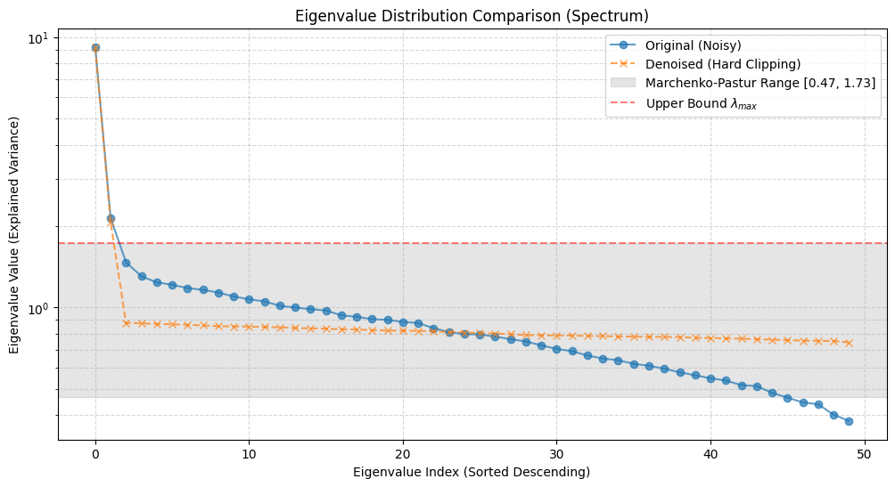
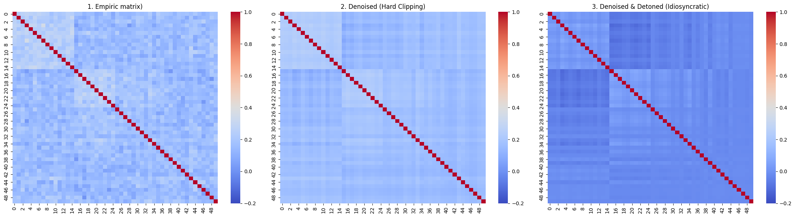
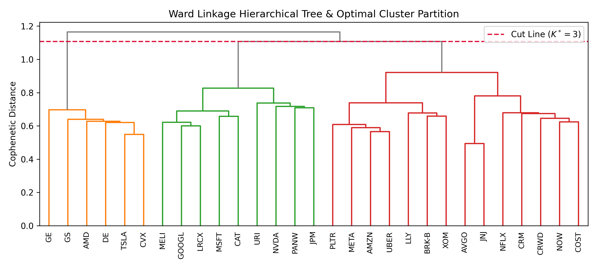
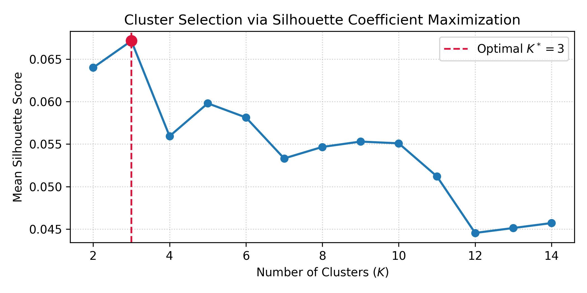
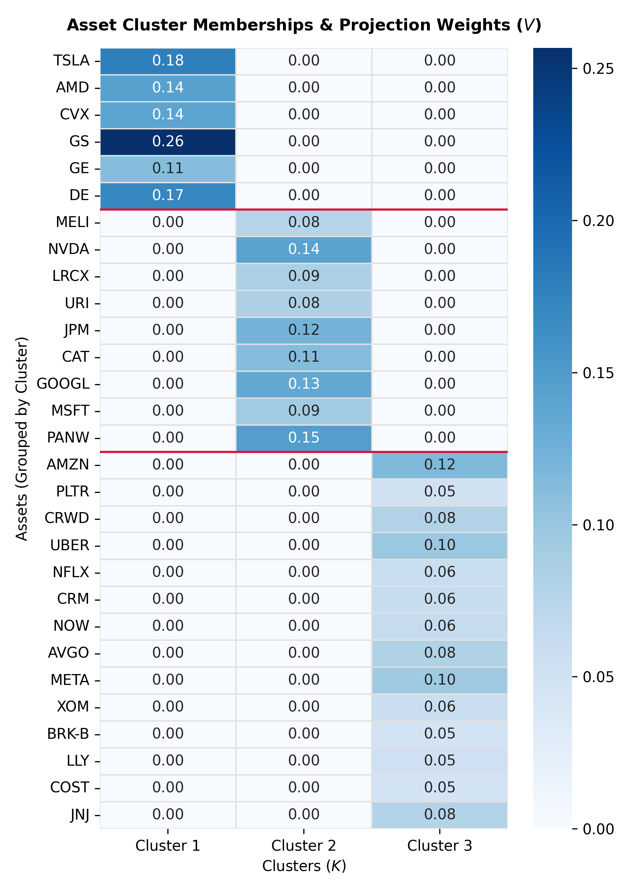
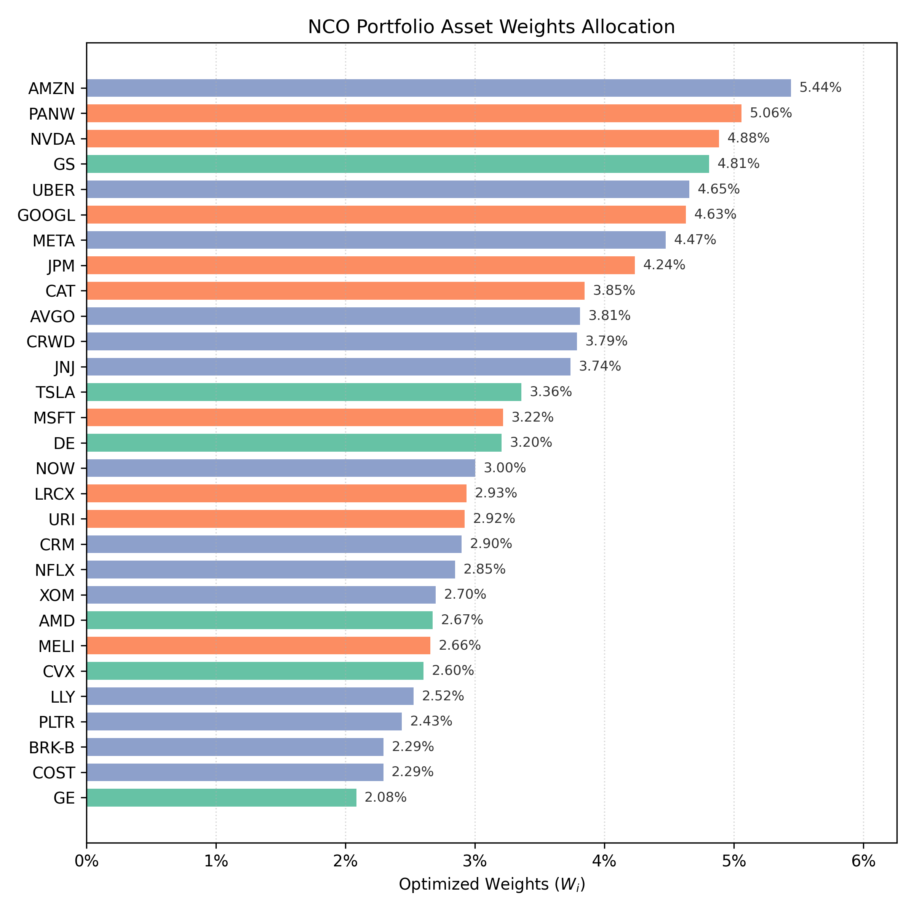

# quant-portfolio-NCO

**Institutional-Grade Nested Clustered Optimization (NCO) Engine with Marchenko-Pastur PCA Spectral Filtering, Equal Risk Contribution, and Shrinkage-Regularized Momentum Alpha**

## 1. Overview & Executive Summary

Modern Portfolio Theory (MPT) and classical single-stage Mean-Variance Optimization (MVO) suffer from severe out-of-sample numerical instability—a structural failure mode widely known as **"Markowitz's Curse."** When the cross-sectional asset dimension $N$ is non-negligible relative to the historical observation window $T$, sample covariance matrices ($\hat{\Sigma}$) become ill-conditioned with inflated condition numbers, while sample mean return vectors ($\hat{\mu}$) are dominated by estimation error. Inverting $\hat{\Sigma}$ in a global quadratic solver exponentially magnifies input noise, concentrating capital into statistically collinear securities and degrading out-of-sample Sharpe ratios.

**`quant-portfolio-NCO`** implements a modular, dual-loop **Nested Clustered Optimization (NCO)** pipeline based on Marcos Lopez de Prado's graph-theoretic allocation framework, enhanced with Random Matrix Theory (RMT) spectral filtering and shrinkage-regularized momentum expectations:

1. **Marchenko-Pastur PCA Denoising & Detoning:** Separates true structural market signals from random sampling noise by fitting the Marchenko-Pastur probability density function to the empirical correlation spectrum, clipping noisy principal components, and stripping the dominant market eigenvector (detoning) to reveal pure idiosyncratic/sectoral codependencies.

2. **Unsupervised Metric Partitioning:** Projects the detoned correlation matrix into a non-negative Euclidean metric space and partitions the universe into $K^*$ statistically distinct clusters via Ward's minimum-variance hierarchical agglomerative linkage.

3. **Inner-Loop Risk Neutralization (Intra-Cluster):** Isolates local collinearity by solving strictly risk-based allocations—**Equal Risk Contribution (ERC)** or **Minimum Variance (MinVar)**—within each isolated cluster sub-block, compressing $N$ assets into $K^*$ orthogonalized synthetic meta-assets.

4. **Outer-Loop Alpha Maximization (Inter-Cluster):** Allocates macro capital across the $K^*$ synthetic meta-clusters using a **Maximum Sharpe Ratio** objective driven by volatility-adjusted cross-sectional momentum returns regularized via **James-Stein / Ledoit-Wolf shrinkage**.

### Key Features & Tech Stack

* **Spectral Matrix Sanitization:** Constant residual eigenvalue clipping (PCA denoising) & market mode removal (detoning)

* **Regularized Alpha Engine:** Cross-sectional EWMA momentum extraction paired with linear shrinkage toward the grand cross-sectional mean to prevent outer-loop weight explosions.

| Category | Core Libraries | 
| ----- | ----- | 
| **Numerical & Matrix Algebra** | `numpy`, `scipy`, `pandas` | 
| **Convex Optimization & Risk** | `cvxpy`, `clarabel` | 
| **Machine Learning & Clustering** | `scikit-learn` | 
| **Data Ingestion & Visualization** | `yfinance`, `matplotlib`, `seaborn` | 

## 2. Mathematical Framework

### 2.1 Marchenko-Pastur PCA Denoising & Detoning

Let $R \in \mathbb{R}^{T \times N}$ denote the matrix of discrete simple asset returns over $T$ trading days across $N$ securities, and let $Z \in \mathbb{R}^{T \times N}$ be the standardized return matrix with zero mean and unit variance. The empirical correlation matrix is given by $\hat{C} = \frac{1}{T} Z^\top Z$, admitting the spectral decomposition:

$$
\hat{C} = W \Lambda W^\top = \sum_{i=1}^{N} \lambda_i w_i w_i^\top
$$

where $\Lambda = \text{diag}(\lambda_1, \lambda_2, \dots, \lambda_N)$ contains the ordered eigenvalues ($\lambda_1 \ge \lambda_2 \ge \dots \ge \lambda_N$) and $W = [w_1, \dots, w_N]$ contains the corresponding orthonormal eigenvectors.

Under Random Matrix Theory (RMT), for an i.i.d. random matrix with aspect ratio $q = \frac{N}{T} \in (0, 1)$ as $N, T \rightarrow \infty$, the eigenvalues of pure noise follow the **Marchenko-Pastur probability density function**:

$$
f_{\text{MP}}(\lambda) = \begin{cases} \frac{T}{2\pi \sigma^2 N \lambda} \sqrt{(\lambda_+ - \lambda)(\lambda - \lambda_-)} & \text{if } \lambda \in [\lambda_-, \lambda_+] \\ 0 & \text{otherwise} \end{cases}
$$

where $\sigma^2$ represents the variance of the random bulk and the theoretical spectral bounds $\lambda_{\pm}$ are defined as:

$$
\lambda_{\pm} = \sigma^2 \left(1 \pm \sqrt{\frac{N}{T}}\right)^2
$$

**PCA Eigenvalue Clipping (Denoising):** We fit $\sigma^2$ by minimizing the sum of squared errors between the empirical spectral distribution and $f_{\text{MP}}(\lambda)$. Any eigenvalue $\lambda_i \le \lambda_+$ is classified as random sampling noise. Using the *Constant Residual Eigenvalue* method, all noise eigenvalues are replaced by their average value to preserve the trace of the correlation matrix:

$$
\tilde{\lambda}_i = \begin{cases} \lambda_i & \text{if } \lambda_i > \lambda_+ \quad (i = 1, \dots, M) \\ \frac{1}{N - M} \sum_{j=M+1}^{N} \lambda_j & \text{if } \lambda_i \le \lambda_+ \quad (i = M+1, \dots, N) \end{cases}
$$

The denoised correlation matrix is reconstructed and rescaled to enforce a unit diagonal:

$$\widehat{C}_{\text{raw denoised}}=W\widetilde{\Lambda}W^\top,\qquad\widetilde{C}=D_{\widetilde{C}}^{-1/2}\widehat{C}_{\text{raw denoised}}D_{\widetilde{C}}^{-1/2}$$

where $D_{\widetilde{C}}=\{diag}\left(\widehat{C}_{\text{raw denoised}}\right)$.

<p align="center">
  
</p>
<p align="center">
  <em>Figure 1: Empirical eigenvalue distribution against the theoretical Marchenko-Pastur noise boundary. Components inside the noise band are clipped to their mean level.</em>
</p>

**Market Mode Removal (Detoning):** The largest eigenvalue $\tilde{\lambda}_1$ and its dominant eigenvector $w_1$ represent the pervasive market factor. Removing this global mode isolates structural sector and industry relationships for clustering:

$$
C_{\text{detoned}} = \tilde{C} - \tilde{\lambda}_1 w_1 w_1^\top, \quad C_{\text{clean}} = \text{diag}(C_{\text{detoned}})^{-1/2} C_{\text{detoned}} \text{diag}(C_{\text{detoned}})^{-1/2}
$$

**Covariance Re-toning:** While $C_{\text{clean}}$ is passed to the clustering engine, convex portfolio optimizers require full volatility scaling. Using the diagonal empirical standard deviation matrix $D_\sigma = \text{diag}(\hat{\sigma}_1, \dots, \hat{\sigma}_N)$, the regularized covariance matrix is reconstructed as:

$$
\hat{\Sigma}_{\text{clean}} =  \left( D_\sigma \tilde{C} D_\sigma \right)
$$

<p align="center">
  
</p>
<p align="center">
  <em>Figure 2: Correlation matrix transformation across three stages: (1) Raw empirical sample correlation, (2) Marchenko-Pastur denoised correlation, and (3) Detoned idiosyncratic correlation ready for distance-tree clustering.</em>
</p>

### 2.2 Metric Space Transformation & Ward Hierarchical Clustering

Because Pearson correlation $\rho_{i,j} \in [-1, 1]$ does not satisfy the triangle inequality required of a true metric space, $C_{\text{clean}}$ is mapped into an ultrametric-compatible Euclidean distance matrix $D \in \mathbb{R}^{N \times N}$:

$$
D_{i,j} = \sqrt{\frac{1}{2}\left(1 - C_{\text{clean}, i, j}\right)}
$$

We apply **Ward's Minimum Variance Agglomerative Clustering**, which merges cluster pairs $(I_u, I_v)$ at each step of the dendrogram to minimize the increase in total within-cluster sum of squares:

$$
\Delta(I_u, I_v) = \frac{\vert I_u \vert \cdot \vert I_v \vert}{\vert I_u \vert + \vert I_v \vert} \Vert c_u - c_v \Vert_2^2
$$

The optimal number of clusters $K^* \in \{2, \dots, K_{\max}\}$ is selected automatically by maximizing the global **Silhouette Coefficient** across all candidate cuts of the linkage tree.

<p align="center">
  
  
</p>
<p align="center">
  <em>Figure 3: Left: Ward's linkage dendrogram cut at the optimal threshold (K=3). Right: Mean Silhouette score across candidate partitions, confirming K=3 as the global structural optimum.</em>
</p>

### 2.3 Inner Loop: Intra-Cluster Risk Optimization

Given the partition $\{I_1, I_2, \dots, I_{K^*}\}$, each cluster $k$ extracts its localized covariance sub-block $\Sigma_k \in \mathbb{R}^{\vert I_k \vert \times \vert I_k \vert}$ from $\hat{\Sigma}_{\text{clean}}$. To prevent noise amplification among collinear assets, expected returns are strictly omitted in the inner loop. The user can configure either **Minimum Variance (MinVar)** or **Equal Risk Contribution (ERC)**:

* **Option A — Minimum Variance (MinVar):**

  $$v_k^\star = \arg\min_{v_k \in \mathbb{R}^{\vert I_k \vert}} \; v_k^\top \Sigma_k v_k \quad \text{s.t.} \quad \mathbf{1}^\top v_k = 1, \quad v_k \ge 0$$

* **Option B — Equal Risk Contribution (ERC / Risk Parity):** Equalizes the marginal risk contribution $\text{RC}_i(v_k)$ of every constituent asset $i \in I_k$ to the total intra-cluster volatility.

To guarantee a unique solution without corner solutions on highly collinear clusters, this pipeline implements **Spinu’s (2013) algorithm**. Spinu reframes the ERC objective away from standard quadratic programming, solving it instead as the minimization of a strictly convex, self-concordant function $F(x)$ via a Nesterov-damped Newton method:

$$w_k^\star = \arg\min_{w \in \mathbb{R}_{++}^{|I_k|}}\left(
\frac{1}{2}w^\top \Sigma_k w-\sum_{i \in I_k} \ln(w_i)\right)$$

The resulting solution is normalized to satisfy the fully-invested constraint:

$$
v_k^\star =
\frac{w_k^\star}{\mathbf{1}^\top w_k^\star}
$$

The optimal intra-cluster weight vectors $\{v_1, \dots, v_{K}\}$ are assembled into a sparse, block-diagonal cluster projection matrix $V \in \mathbb{R}^{N \times K}$:

$$
V_{i,k} = \begin{cases}
v_{k,i}^\star & \text{if asset } i \in I_k \\
0 & \text{otherwise}
\end{cases}
$$

<p align="center">
  
</p>
<p align="center">
  <em>Figure 4: Sparse block-diagonal projection matrix 𝑉 ∈ ℝ𝑁×3 solved via <strong>Equal Risk Contribution (ERC)</strong>. Assets are grouped by cluster partition (red dividers). ERC equalizes marginal risk contributions within each cluster, preventing corner solutions (zero-weights) and ensuring 𝟏⊤𝑣𝑘 = 1 with zero inter-cluster leakage.</em>
</p>

### 2.4 Momentum-Adjusted Shrinkage Returns & Outer-Loop Max Sharpe

**Momentum & Shrinkage Formulation:** For each asset $i \in \{1, \dots, N\}$, we compute an exponentially weighted, volatility-adjusted momentum signal over lookback window $L$ with decay half-life $H$ (decay rate $\lambda_{\text{decay}} = \frac{\ln(2)}{H}$):

$$\mu_{\text{mom}, i} = \frac{1}{\hat{\sigma}_i} \sum_{\tau=1}^{L} \tilde{w}_\tau r_{i, t-\tau}, \quad \tilde{w}_\tau = \frac{\exp(-\lambda_{\text{decay}} \tau)}{\sum_{s=1}^{L} \exp(-\lambda_{\text{decay}} s)}$$

To mitigate estimation variance in extreme momentum outliers, raw momentum signals are shrunk via **James-Stein / Empirical Bayes linear shrinkage** toward the cross-sectional grand mean with shrinkage intensity $\alpha \in [0, 1]$:

$$
\bar{\mu}_0 = \frac{1}{N} \sum_{i=1}^{N} \mu_{\text{mom}, i}
$$

$$
\hat{\mu}_{\text{shrunk}} = (1 - \alpha) \mu_{\text{mom}} + \alpha \bar{\mu}_0 \mathbf{1}_N
$$

**Outer-Loop Projection & Max Sharpe Optimization:** We project the $N$-dimensional return vector and covariance matrix onto the reduced $K^*$-dimensional meta-asset space:

$$
\mu_{\text{outer}} = V^\top \hat{\mu}_{\text{shrunk}} \in \mathbb{R}^{K^*}, \quad \Sigma_{\text{outer}} = V^\top \hat{\Sigma}_{\text{clean}} V \in \mathbb{R}^{K^* \times K^*}
$$

The outer loop solves for the inter-cluster allocation vector $\omega^* \in \mathbb{R}^{K^*}$ that maximizes the **Sharpe Ratio** (solved as a convex conic quadratic program via the Charnes-Cooper transformation):

$$
\omega^* = \arg\max_{\omega \in \mathbb{R}^{K^*}} \; \frac{\omega^\top \mu_{\text{outer}} - r_f}{\sqrt{\omega^\top \Sigma_{\text{outer}} \omega}} \quad \text{s.t.} \quad \mathbf{1}^\top \omega = 1, \quad 0 \le \omega_k \le \min_{i \in I_k} \left(\frac{w_{\max}}{V_{i,k}}\right)
$$

where $w_{\max}$ enforces the global single-security concentration cap.

**Final Portfolio Synthesis:** The deployed $N \times 1$ asset weight vector $w_{\text{final}}$ is synthesized via linear matrix multiplication:

$$
w_{\text{final}} = V \omega^*
$$

<p align="center">
  
</p>
<p align="center">
  <em>Figure 5: Final synthesized portfolio allocations (w_final). Colors indicate cluster assignment, illustrating balanced diversification across meta-clusters.</em>
</p>

## 3. Repository Structure

```
quant-portfolio-NCO/
│
├── assets/                       # Illustrative graphs for README.md
│
├── src/
│   ├── __init__.py
│   ├── data_loader.py            # Market data ingestion & simple returns
│   ├── denoising.py              # Marchenko-Pastur PCA clipping & detoning
│   ├── clustering.py             # Metric distance mapping & Ward linkage
│   └── optimizer.py              # Dual-loop NCO solver
├── .gitignore
├── LICENSE
├── README.md
└── requirements.txt

```

## 4. Getting Started & Installation

### 4.1 Local Environment Setup (`venv` or `conda`)

1. **Clone the repository:**

   ```
   git clone https://github.com/Corlet0/quant-portfolio-NCO.git
   cd quant-portfolio-NCO
   
   ```

2. **Create and activate an isolated virtual environment:**

   * Using `venv`:

     ```
     python3 -m venv .venv
     source .venv/bin/activate        # macOS / Linux
     # .\.venv\Scripts\Activate.ps1   # Windows PowerShell
     
     ```

   * Using `conda`:

     ```
     conda create -n quant-nco python=3.11 -y
     conda activate quant-nco
     
     ```

3. **Install required dependencies:**

   ```
   pip install --upgrade pip
   pip install -r requirements.txt
   
   ```

### 4.2 Google Colab Cloud Execution

To execute the modular pipeline directly inside a Google Colab runtime, run this in your first cell:

```
!git clone https://github.com/Corlet0/quant-portfolio-NCO.git
%cd quant-portfolio-NCO
!pip install -q -r requirements.txt

%load_ext autoreload
%autoreload 2
import sys
sys.path.append('.')

```

## 5. Usage & Quickstart

### 5.1 Python API Quickstart

The modular `src/` architecture enables end-to-end execution in a few lines of Python:

```
import yfinance as yf
from src.data_loader import *
from src.denoising_and_detoning import *
from src.clustering import *
from src.optimisation import *

start = '2024-10-31'
end = '2026-10-30'
 # 1. Ingest Multi-Sector Universe (Simple Daily Returns)
tickers = [
    "AAPL", "MSFT", "NVDA", "GOOGL", "AMZN",  # Technology & Communications
    "JPM", "BAC", "GS", "MS",                 # Financials
    "XOM", "CVX", "COP",                      # Energy
    "JNJ", "UNH", "PFE", "PG", "KO"           # Healthcare & Consumer Staples
]
raw_returns = returns_download(tickers, start, end)

# 2. Marchenko-Pastur PCA Denoising & Market Detoning 
clean_corr, clean_cov = denoise_and_detone(raw_returns, detone=True)
   

# 3. Unsupervised Hierarchical Clustering (Ward Linkage + Silhouette Optimization)
asset_cluster_ids, optimal_num_clusters, linkage_tree = find_optimal_clusters(clean_corr)

# 4. Execute Dual-Loop NCO (Inner: ERC | Outer: Max Sharpe)
  # 4.1 Inner Weights 
inner_W = inner_cluster_weights(clean_cov, asset_cluster_ids, method='ERC')  # Options: "ERC" or "MinVar"
  # 4.2 Outer and final Weights
NCO, outer_W = run_nco_outer_pipeline(raw_returns, clean_cov, inner_W)

print(f"Optimal Clusters Identified: K* = {optimal_num_clusters}")
print("\nDeployed NCO Portfolio Weights:")
print(NCO)

```

## 6. Strategy Workflow & Parameters

```
[Raw Daily Prices (T x N)]
   │
   ▼
[Discrete Simple Returns] ───────────────────────────────────────────────────┐
   │                                                                         │
   ▼                                                                         ▼
[Marchenko-Pastur PCA Denoising]                               [Expected Returns Estimation]
   │                                                  (Sortino Momentum + James-Stein Shrinkage: μ_JS)
   ▼                                                                         │
[Market Mode Detoning (C_clean)]                                             │
   │                                                                         │
   ├──────────────────────────────────────┐                                  │
   ▼                                      ▼                                  │
[Distance D = sqrt(0.5*(1 - C_clean))] [Re-toned Covariance (Σ_retoned)]     │
   │                                      │                                  │
   ▼                                      │                                  │
[Ward Tree & Silhouette (K* Clusters)]    │                                  │
   │                                      │                                  │
   └──────────────────┬───────────────────┘                                  │
                      ▼                                                      │
     [Inner Loop: Intra-Cluster ERC / MinVar (Matrix V)]                     │
                      │                                                      │
                      ▼                                                      │
     [Outer Loop: Max Sharpe across K* Synthetic Meta-Assets] ◄──────────────┘
          (Σ_outer = V' Σ_retoned V,  μ_outer = V' μ_JS)
                      │
                      ▼
     [Final Synthesized Portfolio Weights: w_final = V * ω*]           

```

## 7. References

1. **Lopez de Prado, M. (2019).** *A Robust Estimator of the Efficient Frontier.* Available at SSRN 3469961.

2. **Lopez de Prado, M. (2020).** *Machine Learning for Asset Managers.* Cambridge University Press (Elements in Quantitative Finance).

3. **Marchenko, V. A. & Pastur, L. A. (1967).** Distribution of eigenvalues for some sets of random matrices. 

4. **Laloux, L., Cizeau, P., Bouchaud, J. P., & Potters, M. (1999).** *Noise Dressing of Financial Correlation Matrices.* Physical Review Letters, 83(7), 1467.

5. **Maillard, S., Roncalli, T., & Teiletche, J. (2010).** *The Properties of Equally Weighted Risk Contribution Portfolios.* The Journal of Portfolio Management, 36(4), 60-70.
   
6. **Spinu, F. (2013).** An Algorithm for Computing Risk Parity Weights. Available at SSRN 2297383 

## 8. Disclaimer

**IMPORTANT LEGAL DISCLAIMER:**

This repository (`quant-portfolio-NCO`), including all accompanying source code, mathematical models, research notebooks, and documentation, is provided strictly for **academic, educational, and quantitative research purposes only**. Nothing contained herein constitutes financial, investment, legal, or tax advice, nor should it be construed as a solicitation or recommendation to buy, sell, or hold any security, cryptocurrency, derivative, or financial instrument.

Quantitative trading and portfolio optimization involve substantial risk of capital loss. Past backtested or simulated performance is not indicative of future out-of-sample results and may not reflect the full impact of market illiquidity, regime shifts, slippage, or execution frictions. The authors and contributors assume no liability for any financial losses or damages incurred from the use or deployment of this software.
